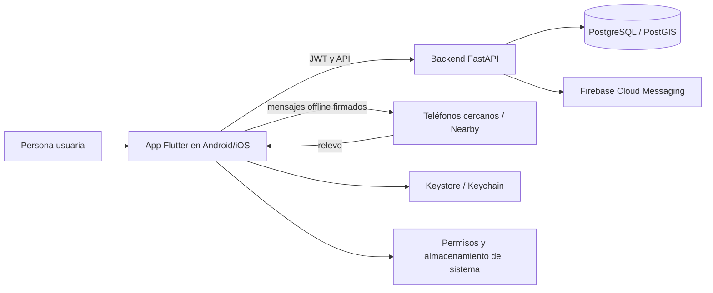

# Auditoría de seguridad móvil — RESCATE360

**Fecha:** 16 de noviembre de 2026  
**Alcance:** `rescate360-fe` (Flutter/Android) y los endpoints backend que reciben identidad y mensajes offline.  
**Base de revisión:** rama local `feature/sinConexion`.

## Resumen

RESCATE360 maneja identidad, tokens de sesión, contactos de emergencia, ubicación precisa, reportes y mensajes de socorro. La app ya guardaba tokens en Android Keystore/iOS Keychain y el backend validaba JWT, roles y la firma HMAC de los mensajes offline. La revisión encontró riesgos en la configuración de red release, el almacenamiento local de la cola offline, los datos recibidos por Nearby, las copias de seguridad y los logs del token FCM.

Se aplicaron cambios en esas cinco áreas. También se configuró R8 y la ofuscación de Dart para el script de entrega. La verificación estática y un smoke test focalizado pasaron. La suite Flutter no terminó en este entorno y el APK release endurecido no se compiló; estos resultados quedan como pendientes, no como pruebas aprobadas.

## Modelo de amenazas

### Componentes y límites de confianza

El teléfono, su red y otros teléfonos cercanos se consideran no confiables. Las decisiones de autorización deben permanecer en el backend.

| Activo | Dato tratado | Dónde / flujo | Impacto si se expone o altera |
|---|---|---|---|
| Sesión | Access token y refresh token | App → API; Keystore/Keychain | Suplantación de cuenta |
| Llave offline | Clave HMAC del usuario | Backend → almacenamiento seguro | Falsificación de mensajes offline |
| Ubicación | Coordenadas exactas y dirección | Reportes, SOS, cola offline y relevo Nearby | Riesgo físico y de privacidad |
| Datos de emergencia | Descripción, tipo, contactos y estado | App ↔ API; cola offline | Exposición de personas en riesgo |
| Token FCM | Identificador de dispositivo | App → backend/Firebase | Notificaciones dirigidas al dispositivo |
| Evidencias | Fotos y videos de incidentes | App → backend/almacenamiento | Exposición de personas o menores |

### Amenazas principales

1. Un atacante en la misma red intercepta tráfico HTTP de un build release.
2. Una persona que obtiene el dispositivo o una copia de sus datos lee la cola offline o una copia de seguridad.
3. Un dispositivo cercano envía un lote manipulado o excesivo por Nearby.
4. Un atacante reutiliza tokens o intenta una acción de otro rol; el backend debe validar sesión y permisos en cada petición.
5. Una persona con acceso a Logcat o a registros de depuración obtiene identificadores de notificación.

## Auditoría OWASP Mobile Top 10 (2024)

| ID | Riesgo | Estado | Justificación y evidencia |
|---|---|---|---|
| M1 | Improper Credential Usage | **Parcial** | No se detectaron claves de backend embebidas en el código revisado; `.env` y la configuración Firebase están ignorados por Git. Se retiró el log del token FCM. No se hizo un escaneo completo del historial Git ni del APK final. |
| M2 | Inadequate Supply Chain Security | **Parcial** | Existe `pubspec.lock`. `dart pub outdated --no-dev-dependencies` encontró 17 dependencias fijadas a versiones más antiguas. Esto no demuestra una CVE; queda pendiente un escaneo de advisories y actualización controlada. |
| M3 | Insecure Authentication/Authorization | **Cumple en los endpoints revisados** | Los endpoints offline requieren `get_current_user`; el backend verifica JWT y estado de cuenta. Las decisiones de rol se validan en el servidor, no solo ocultando pantallas. |
| M4 | Insufficient Input/Output Validation | **Corregido parcialmente** | El backend valida el lote offline con Pydantic. La app ahora limita tamaño y cantidad del lote Nearby y valida tipo, UUID, firma, fechas, saltos, coordenadas y campos de reporte antes de procesarlo. No se auditó cada formulario/deep link de la app en esta actividad. |
| M5 | Insecure Communication | **Corregido para Android release** | Antes el manifiesto principal permitía HTTP. Ahora lo prohíbe; solo el manifiesto debug conserva HTTP para el backend local. El script de APK compartido ya exige HTTPS. iOS conserva ATS por defecto, sin excepciones añadidas. |
| M6 | Inadequate Privacy Controls | **Parcial** | La app solicita ubicación en uso y explica su finalidad. La cola offline queda protegida localmente. Sigue pendiente mostrar y validar una confirmación de identidad/consentimiento del par Nearby antes de compartir datos de emergencia. |
| M7 | Insufficient Binary Protections | **Parcial** | R8, reducción de recursos y ofuscación Dart están configurados. El APK no se compiló en esta verificación y la configuración aún firma localmente con la llave debug; no debe distribuirse como APK de producción. |
| M8 | Security Misconfiguration | **Corregido en los controles revisados** | Se desactivaron cleartext en release y backups automáticos Android. La única Activity exportada es la launcher requerida. Los permisos principales son Internet y ubicación; los permisos de cámara/fotos están declarados donde se justifican. |
| M9 | Insecure Data Storage | **Corregido para tokens y cola offline** | Access/refresh, llave offline y cola se guardan mediante `flutter_secure_storage`. Al leer una instalación anterior, la cola de `SharedPreferences` se migra a almacenamiento seguro y se elimina del origen. Las preferencias de tema/idioma no contienen datos de emergencia. |
| M10 | Insufficient Cryptography | **Cumple en el flujo offline revisado** | La app firma con HMAC-SHA256; el servidor calcula la firma esperada y compara de forma constante. La llave offline se entrega por endpoint autenticado y se guarda en almacenamiento seguro. |

## Hallazgos y correcciones

### H-01 — HTTP permitido en release (M5, alto)

- **Antes:** `android:usesCleartextTraffic="true"` estaba en el manifiesto principal, por lo que también aplicaba al build release.
- **Corrección:** `src/main/AndroidManifest.xml` lo establece en `false`; `src/debug/AndroidManifest.xml` mantiene `true` solo para pruebas con API local.
- **Verificación:** lectura XML de ambos manifiestos y comprobación de que release=false/debug=true. `git diff --check` pasó.
- **Límite:** falta inspeccionar el manifiesto fusionado del APK release y probar la app en un dispositivo.

### H-02 — Cola offline en preferencias sin protección (M9, alto)

- **Antes:** reportes, coordenadas y mensajes recibidos se guardaban como texto JSON en `SharedPreferences`.
- **Corrección:** `OfflineQueue` guarda los lotes con `SecureStorage` (Keystore/Keychain). Al detectar datos heredados, los copia al almacenamiento seguro y retira las claves antiguas de preferencias. Android no restaura automáticamente datos de la app desde backups.
- **Verificación:** análisis de Dart sin problemas en los archivos cambiados y revisión estática del camino de migración.
- **Límite:** falta comprobar la migración en un teléfono Android y en iOS; la suite Flutter no terminó en este entorno.

### H-03 — Lotes Nearby sin límites y validación local insuficiente (M4, medio)

- **Antes:** se decodificaba el JSON recibido y se convertía en mensajes sin límite de bytes ni validación de campos en el dispositivo.
- **Corrección:** máximo 64 KiB y 50 mensajes por lote; se validan IDs UUID, tipos, firma hexadecimal, coordenadas, fecha, saltos y campos del reporte.
- **Verificación:** smoke test Dart focalizado pasó para un mensaje válido, latitud fuera de rango, exceso de saltos, payload mayor de 64 KiB y lote con más de 50 mensajes. El análisis de los archivos modificados no encontró problemas.
- **Límite:** el servidor sigue siendo la autoridad final; la app no toma la firma local como sustituto de la validación del backend.

### H-04 — Backups Android sin restricción explícita (M8/M9, medio)

- **Antes:** el manifiesto no definía `allowBackup`; el sistema podía incluir datos de app en mecanismos de respaldo compatibles.
- **Corrección:** `android:allowBackup="false"` en el manifiesto principal.
- **Verificación:** comprobación XML del valor aplicado.
- **Límite:** no se probó restauración desde una copia de seguridad de un dispositivo.

### H-05 — Token FCM en logs de depuración (M1, medio)

- **Antes:** el servicio imprimía el token FCM y títulos de notificaciones cuando la app estaba en modo debug.
- **Corrección:** se retiraron esos `print`; el token sigue guardándose en `flutter_secure_storage`.
- **Verificación:** búsqueda estática sin llamadas `print` en `push_notification_service.dart`.

### Endurecimiento adicional — Release y R8 (M7)

El build `release` declara `isDebuggable=false`, `isMinifyEnabled=true`, `isShrinkResources=true` y reglas de R8. El script `scripts/compilar-apk.ps1` activa `--obfuscate` y conserva símbolos en `build/symbols/android` para diagnóstico. Falta generar e inspeccionar el APK resultante. La llave debug actual es solo para desarrollo local; antes de distribuir, debe configurarse una llave privada de release fuera del repositorio.

## Verificación ejecutada

| Prueba | Resultado |
|---|---|
| `dart analyze` sobre los seis archivos Dart modificados y la prueba de mensajes | **Sin problemas** |
| Smoke test de decodificación/validación Nearby | **Pasó** |
| Inspección XML: HTTP release/debug, backup Android | **Pasó** |
| Inspección Gradle y script: R8, `isDebuggable=false`, ofuscación Dart | **Pasó** |
| `git diff --check` | **Pasó** |
| `dart analyze` de todo el frontend | **1 warning preexistente** en `auth_viewmodel.dart` y 31 sugerencias/info; sin errores en los archivos modificados |
| `dart pub outdated --no-dev-dependencies` | **17 dependencias fijadas a versiones más antiguas**; no es por sí solo un informe de vulnerabilidades |
| `flutter test test/core/mensaje_offline_test.dart` | **No concluyó**: quedó sin salida durante varios minutos y se canceló; no se considera aprobado |
| Build release R8/ofuscado y prueba en teléfono | **Pendiente** |

## Pendientes antes de cerrar la entrega

1. Ejecutar `flutter test test/core/mensaje_offline_test.dart` y la suite completa en un entorno Flutter que responda.
2. Compilar el APK release con `scripts/compilar-apk.ps1`, revisar el manifiesto fusionado y comprobar que no permite HTTP.
3. Configurar una llave privada de release fuera del repositorio antes de distribuir el APK.
4. Verificar en dispositivo que una cola previa migra correctamente y que no reaparece en `SharedPreferences`.
5. Ejecutar un escáner de advisories sobre `pubspec.lock`; actualizar dependencias compatibles sin subir versiones mayores a ciegas.
6. Añadir confirmación de identidad y consentimiento para el intercambio Nearby antes de transferir ubicación o descripciones.
7. Capturar evidencia antes/después de los cinco hallazgos y adjuntarla al informe final de clase, sin tokens ni datos personales reales.

## Guion para demostración de 10 minutos

| Minuto | Demostración |
|---:|---|
| 0–1 | Explicar RESCATE360, los datos sensibles y los límites de confianza del diagrama. |
| 1–2 | Mostrar el manifiesto: HTTP desactivado en release y disponible solo en debug local. |
| 2–3 | Mostrar el almacenamiento seguro de sesión, llave offline y cola; explicar la migración desde preferencias. |
| 3–5 | Ejecutar las pruebas de mensajes: válido, coordenada inválida, demasiados saltos y lote excesivo. |
| 5–6 | Mostrar la protección de backups y permisos justificados en Android/iOS. |
| 6–7 | Mostrar que el backend exige JWT y verifica HMAC antes de aceptar mensajes. |
| 7–8 | Compilar release y mostrar R8/ofuscación; aclarar que el APK local aún usa llave debug. |
| 8–9 | Revisar Logcat y tráfico HTTPS con datos de prueba sintéticos. |
| 9–10 | Resumir hallazgos abiertos: advisories de dependencias, verificación en dispositivo y consentimiento Nearby. |

## Evidencia de archivos

- `android/app/src/main/AndroidManifest.xml`
- `android/app/src/debug/AndroidManifest.xml`
- `android/app/build.gradle.kts`
- `android/app/proguard-rules.pro`
- `lib/core/storage/secure_storage.dart`
- `lib/core/offline/offline_queue.dart`
- `lib/core/offline/mensaje_offline.dart`
- `lib/core/offline/nearby_mesh.dart`
- `lib/core/services/push_notification_service.dart`
- `scripts/compilar-apk.ps1`
- `test/core/mensaje_offline_test.dart`
- Backend: `app/middlewares/auth_middleware.py`, `app/schemas/offline_schema.py`, `app/services/offline_service.py`
